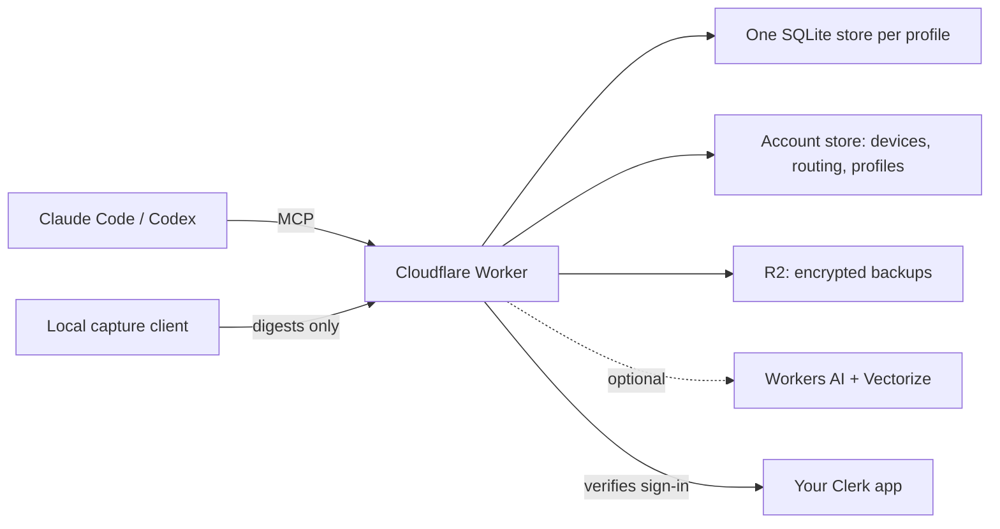

# Agent Memory

A shared memory for your coding agents. Claude Code and Codex save decisions, rules and context here, and recall them later in any session, on any machine. You stop explaining the same things twice.

It runs on your own Cloudflare account, with sign-in through your own Clerk application. Each deployment serves one owner; it is not a shared service.

## Status

The owner's everyday service runs version 1 and has replaced BothQ for daily use. BothQ stays running and readable as a fallback. Version 2 is built and reviewed in source, but it isn't released on the everyday service yet.

- [x] Version 1 on the everyday service: imported and audited records, save, journal, recall and history, backup and restore, and the owner's clients connected.
- [x] Version 2 built and reviewed in source: recall evaluation, scheduled consolidation, richer capture, session replay and the new dashboard.
- [ ] Release the keep-all manual export, and use it before the version 2 upgrade.
- [ ] Version 2 checked on the hosted test deployment (#39).
- [ ] Version 2 released to the everyday service (#40).

Details and evidence: [feature manifest](docs/feature-manifest.md) and [verification records](docs/import-verification.md).

## Features

This list describes the source. The status above says what is released.

- **One memory for all your agents.** Claude Code and Codex connect over MCP. Desktop clients sign in through Clerk, and headless machines use a revocable device token.
- **Separate profiles.** `work`, `personal` and `me` keep their memories apart. The agent picks the profile; storage never guesses from the content. Recall reads the chosen profile plus `me`. An owner-only wipe can remove `work` on its own.
- **Linked knowledge.** Decisions carry their reasons and evidence, and records link to projects, people and work items. Agents can ask why something was decided, follow a path between records or read a timeline.
- **Search that works without AI.** Recall uses exact names and full-text search. Semantic search with Workers AI is optional.
- **Private capture.** The local client turns sessions into short, redacted digests on your machine. Full transcripts stay on that machine, and you can replay them there.
- **A dashboard.** Browse memories, the graph, sessions, activity and health at `/app`, and manage devices and routing at `/settings`.
- **Backups and recovery.** Nightly encrypted exports go to your own R2 bucket, and the two newest are kept. Profiles and account state can be restored.
- **Careful cleanup.** Housekeeping is rule-based, with no model on the server. Stated rules, pinned records and `me` are never changed by the background batch, and changes can be undone.

## How it works



One Worker serves the MCP endpoint, the dashboard and the API. Each profile lives in its own SQLite Durable Object, so profiles never share a database. An account store holds devices, routing rules and the profile list. The Worker checks Clerk's sign-in tokens with Clerk's public keys and needs no Clerk secret.

The full design is in [architecture](docs/architecture.md).

## Deploy your own

There's no one-click "Deploy to Cloudflare" button yet. Cloudflare's button needs a public repository and deploys the repository's own Wrangler config, which here holds the owner's production settings. It also can't set up the Clerk application. Use the self-host package instead. It has been checked on an isolated test deployment in the owner's account, but not yet end to end on anyone else's.

**You need:**
- Node 24.
- A Cloudflare account, ideally on Workers Paid. Use your own domain's zone, or the account's workers.dev subdomain.
- A Wrangler login for that account (`npx wrangler login`, or `CLOUDFLARE_API_TOKEN`). Setup never logs in for you.
- A Clerk production instance on your domain, with sign-ups closed, OAuth (CIMD and PKCE) turned on, and the `memory` scope. The [self-host guide](docs/self-host.md#create-the-clerk-application) lists every setting.

**Steps:**

1. Build the self-host package from this repository. The command prints the archive path.

	```sh
	npm ci
	npm run pack:self-host -- /absolute/existing/output-directory
	```

2. Unpack it into a new directory, outside this repository, and install:

	```sh
	mkdir my-agent-memory
	tar -xzf /path/to/agent-memory-0.0.0.tgz -C my-agent-memory
	cd my-agent-memory/package
	npm ci --include=dev
	```

3. Write `agent-memory.setup.json` with your account id, Worker name, URL, Clerk issuer and publishable key, and routing rules. See [the settings](docs/self-host.md#write-the-settings).
4. Preview the plan, then apply it. Apply asks for your Clerk user id and stores it only as a Worker secret.

	```sh
	npm run setup
	npm run setup -- --apply
	```

5. Deploy, then check the public metadata:

	```sh
	npx wrangler deploy
	curl <your-url>/.well-known/oauth-protected-resource/mcp
	```

Setup creates only what it plans: the Worker config, an R2 bucket and, with semantic search on, a Vectorize index. It refuses rather than overwrite an existing deployment. Backups stay off until you set a backup key; see [backups and restore](docs/self-host.md#profile-backups-and-restore).

## Connect a client

Use your own deployment's URL in place of `https://YOUR-DEPLOYMENT.example/mcp`.

For Claude Code, add the server, then run `/mcp` in Claude Code to sign in:

```sh
claude mcp add --transport http memory https://YOUR-DEPLOYMENT.example/mcp
```

For Codex:

```sh
codex mcp add memory --url https://YOUR-DEPLOYMENT.example/mcp
codex mcp login memory
```

For a machine without a browser, see [headless machines](docs/self-host.md#headless-machines).

## Privacy

- Automatic capture uploads only short, redacted digests of each session, never the full transcript. A digest can contain short excerpts. What an agent saves or imports on purpose is stored as written.
- Full sessions stay on the machine that recorded them. `agent-memory replay --list` and `agent-memory replay --session ID` open a viewer on 127.0.0.1 only, behind a private token, and upload nothing.
- The server never calls GitHub or Jira, and holds no credentials for them.

## Learn more

- [Self-host guide](docs/self-host.md): every setup step, setting and option.
- [Architecture](docs/architecture.md): the design and its decisions.
- [Feature manifest](docs/feature-manifest.md): what is built, tested and released.
- Development: run `npm ci`, then `npm run check`.
